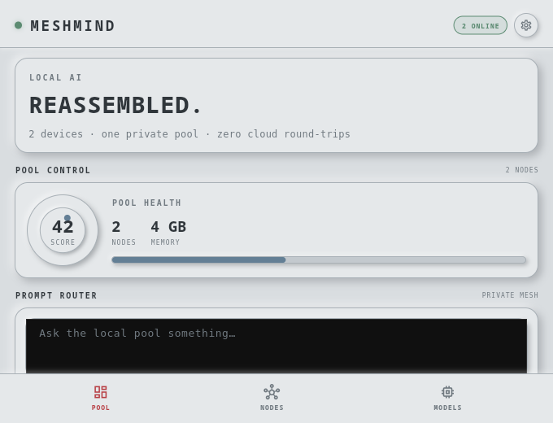
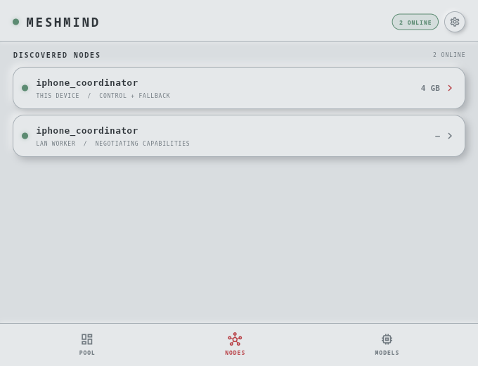
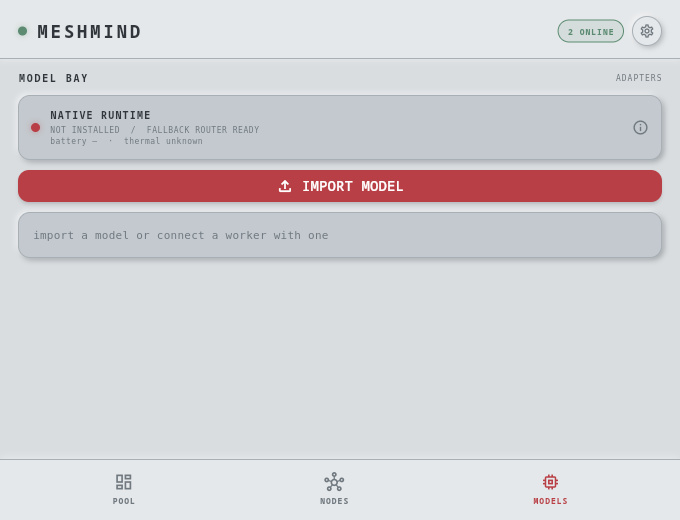

# MeshMind

**Reassemble the hardware you already own into one private local AI mesh.**

MeshMind is a Flutter coordinator and worker app for iOS, Android, Linux,
macOS, and Windows. It discovers nearby devices over Bonjour/mDNS, learns what
each device can run, routes prompts to the best available node, and can use
current llama.cpp RPC to place one GGUF model across local and remote CPU/GPU
devices.

No account. No cloud relay. No central server.

## Screenshots

| Pool control | Discovered nodes | Model Bay |
| --- | --- | --- |
|  |  |  |

## What it does

- Discovers nearby phones, tablets, laptops, desktops, and single-board
  computers with `_meshmind._tcp` Bonjour/mDNS.
- Exchanges capability records containing platform, memory, models, battery,
  thermal state, and supported execution features.
- Streams inference responses through targeted WebSocket envelopes.
- Imports GGUF models from the device Files picker and keeps their paths local.
- Routes named models only to workers that advertise those models.
- Starts `ggml-rpc-server` on desktop-class nodes when a compatible current
  llama.cpp installation is available.
- Sends `--rpc` execution plans to a llama.cpp entrypoint. llama.cpp then
  places model weights and KV cache across local and remote devices using
  actual available device memory.
- Avoids unhealthy workers and retries locally when a worker disappears.
- Works as a useful single-device local app even when no peer is available.

## Architecture

```text
             prompt + selected model
                       │
                       ▼
        ┌────────────────────────────┐
        │ iPhone / MeshMind          │
        │ coordinator + model router │
        └──────────────┬─────────────┘
                       │ mDNS + authenticated WebSocket mesh
          ┌────────────┼─────────────┐
          ▼            ▼             ▼
     old laptop     desktop GPU    mini PC
     llama.cpp      RPC device     CPU RPC device
     entrypoint     contributor    contributor
          └────────────┬────────────┘
                       ▼
             one GGUF model placement
             across local + remote devices
```

The iPhone can coordinate desktop workers and run its own native local GGUF
runtime. Desktop nodes can be inference entrypoints and RPC contributors.
Mobile operating systems do not launch the desktop `ggml-rpc-server` process;
they contribute through the native runtime or act as coordinators when their
platform/runtime supports it.

## Quick start

### Run from source

```bash
flutter pub get
flutter run
```

Build the local desktop target:

```bash
flutter build linux --release
```

The Linux target needs GTK 3 and Avahi. On Arch-based systems:

```bash
sudo pacman -S gtk3 avahi
sudo systemctl enable --now avahi-daemon
```

### Make a legacy laptop a worker

1. Install a llama.cpp completion binary: `llama-cli` from a packaged build,
   or `llama-completion` from current llama.cpp source.
2. Launch MeshMind on the laptop.
3. Import a `.gguf` file in **Model Bay**.
4. Launch MeshMind on the iPhone or another coordinator on the same trusted
   network.

The app automatically detects either executable name and streams local output
without uploading the model or prompt.

### Enable distributed model execution

Build current llama.cpp with RPC enabled on desktop hosts:

```bash
cmake -S . -B build-rpc -DGGML_RPC=ON
cmake --build build-rpc --target llama-completion ggml-rpc-server -j
```

MeshMind starts the RPC worker automatically when both the completion binary
and `ggml-rpc-server` are available. It advertises the LAN endpoint and sends
the coordinator a distributed plan. The entrypoint launches llama.cpp with
`--rpc` and the default `layer` split mode; current llama.cpp sizes placement
from the complete local and remote device set.

For heterogeneous GPUs, build the matching llama.cpp backend on each host,
for example `-DGGML_CUDA=ON -DGGML_RPC=ON` for CUDA. The RPC server exposes
available accelerator devices, or a CPU device when no accelerator is
available.

## Network and security

- All nodes should be on the same trusted subnet or VPN.
- Bonjour/mDNS discovery must be allowed between peers.
- MeshMind WebSockets use per-session join tokens before a peer can forward
  messages.
- WebSocket traffic uses a free port in `5700-5800`.
- llama.cpp RPC uses TCP port `50052` by default.
- Raw llama.cpp RPC is experimental and not encrypted. Do not expose port
  `50052` to the public internet or port-forward it.

The RPC backend is explicitly described by llama.cpp as proof-of-concept,
fragile, and insecure. Read the upstream [RPC documentation][llama-rpc] before
using it outside a controlled LAN.

## Supported platforms

| Platform | Role |
| --- | --- |
| iOS | Coordinator and native local GGUF worker |
| Android | Coordinator/mesh worker; native llama.cpp runtime integration is pending |
| Linux | Coordinator, llama.cpp worker, and RPC entrypoint/contributor |
| macOS | Coordinator, llama.cpp worker, and RPC entrypoint/contributor |
| Windows | Coordinator, llama.cpp worker, and RPC entrypoint/contributor |

## Development

```bash
flutter pub get
flutter analyze
flutter test
flutter build linux --release
```

Important implementation areas:

```text
lib/models/node_capability.dart             capability handshake
lib/models/distributed_execution_plan.dart  RPC placement plan
lib/models/inference_envelope.dart          streaming request protocol
lib/services/chat_service.dart              mDNS + WebSocket mesh
lib/services/inference_service.dart         routing + local adapters
lib/services/rpc_worker_service.dart        desktop RPC lifecycle
lib/screens/mesh_screen.dart                pool, nodes, and Model Bay UI
ios/MeshMindInference/                      native iOS llama.cpp boundary
```

CI runs analysis, tests, Linux builds, and Android builds. Release builds are
published by the tag workflow for Linux, Windows, macOS, and Android where the
runner/toolchain is available.

## Verification

The distributed path has been smoke-tested with current llama.cpp built using
`-DGGML_RPC=ON`: one completion host loaded TinyLlama through two separate CPU
`ggml-rpc-server` processes, both RPC workers recorded client connections, and
the completion exited successfully. MeshMind's Flutter analyzer and test suite
also pass.

## Project documents

- [MeshMind product and architecture plan](docs/MESH_MIND_PLAN.md)
- [iOS native runtime notes](docs/IOS_RUNTIME.md)
- [License](LICENSE)

[llama-rpc]: https://github.com/ggml-org/llama.cpp/blob/master/tools/rpc/README.md

## License

MIT. See [LICENSE](LICENSE).
